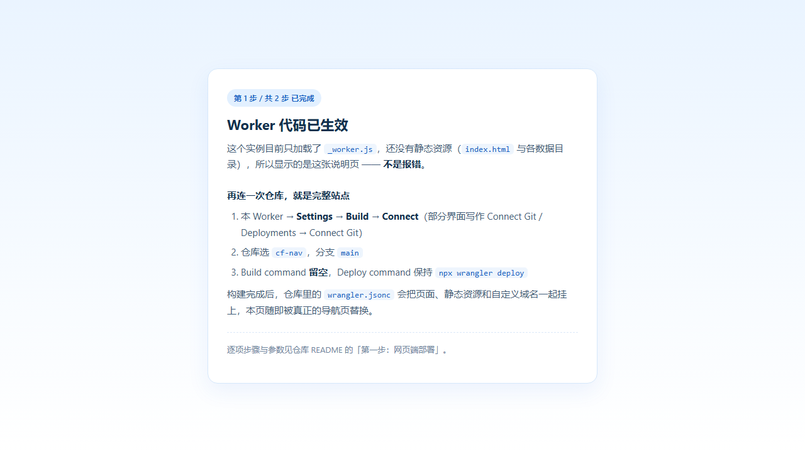
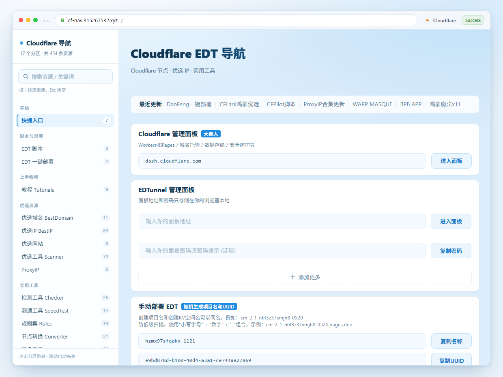
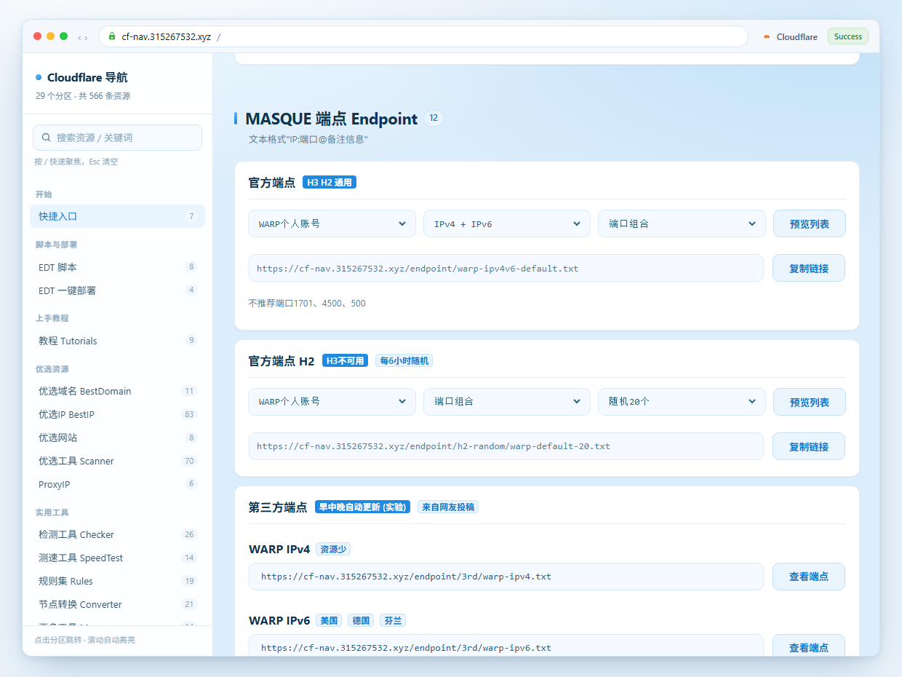

# Cloudflare 导航站（EDT × WARP MASQUE · 静态副本）

Cloudflare 边缘节点 / 优选 IP 导航页的**纯静态**副本，通过 Cloudflare Workers（Static Assets）托管。

在原 EDT 导航的基础上，已把 [WARP MASQUE 导航](https://masque.pages.dev) 的 12 个分区并入同一页面：两个站的上游数据、客户端列表、端点订阅、教程全部合在一处，共用左侧目录、全站搜索和一套浅色主题。

站点结构：一个内联 CSS/JS 的 `index.html`，加若干数据目录和一个单文件 Worker。**没有后端框架、没有构建步骤、没有 npm 依赖**。

页面里的订阅链接**直连上游原站**（`bestcf.pages.dev` / `masque.pages.dev`），数据新鲜度由原站负责。本站不镜像、不回源、不做定时任务 —— 它就是一张导航页。

部署一次就好，不需要本地装任何工具，全程在网页上完成：

1. **把 `_worker.js` 整份粘进 Workers 面板** → 得到叫 `cf-nav` 的 Worker
2. **接上 GitHub 仓库** → 静态资源与自定义域名随之补齐 → 网站可访问（约 3 分钟）

> 顺序说明：面板创建 Worker 时只能填代码、不能上传页面和资源文件，所以先贴代码只是**把 `cf-nav` 这个名字占住**，打开会看到一个引导页；接上仓库后 `wrangler.jsonc` 才会把 `index.html`、静态目录、自定义域名一次性配齐。

## 目录结构

```
.
├── index.html              主页面（约 500KB，CSS/JS 全部内联，30 个分区）
├── favicon.svg
├── _worker.js              单文件 Worker：只做静态托管（可整份粘进面板）
├── CIDR/                   Cloudflare 官方 IP 段（7 个 txt）
├── WARP/                   WARP MASQUE / MINI 优选 IP
├── domain/                 已测域名列表（约 1MB）
├── random-region/          区域权重表
├── endpoint/               MASQUE 端点订阅（46 个 txt：warp/zt × 协议 × 端口）
├── vvhan/ vps789/ ...      各上游的订阅 txt（合计 130 个数据文件，分布在 27 个目录）
├── tools/                  工具子页（204 检测、CIDR 转换、UUID、混淆器等）
├── zt/                     ZeroTrust 注册子页 + 客户端压缩包
├── report/                 报告页
├── assets/                 README 用的截图（不随站点上传）
├── wrangler.jsonc          当前生效的配置（静态资源 + 自定义域名，无 KV / 无 cron）
├── _headers                缓存与安全响应头
└── .assetsignore           不随站点上传到 CDN 的文件清单
```

---

# 第一步：网页端部署

全程在 Cloudflare Dashboard 操作，不需要命令行。分两段：**先把 `_worker.js` 贴进面板**，**再把 GitHub 仓库接上**。

## 1.1 创建 Worker

1. 打开 <https://dash.cloudflare.com>，登录你的 Cloudflare 账号
2. 左侧菜单点 **Workers & Pages**
3. 右上角点 **Create application**（部分界面版本显示为 **Create**）
4. 切到 **Workers** 标签页，选 **Create Worker**（有的界面是 **Start with Hello World!**）
5. **Name** 填 `cf-nav` —— 必须和 `wrangler.jsonc` 里的 `"name"` 完全一致
6. 点 **Deploy**，先用模板自带的代码部署一次（马上就会被替换掉）

> 这里**不要**选 **Import a repository**。那条路是直接连仓库、一步到位，但会跳过贴代码这一步。我们要的正是先有一个名为 `cf-nav` 的空 Worker。

## 1.2 粘贴 `_worker.js`

1. 打开 <https://github.com/looomix/cf-nav/blob/main/_worker.js>
2. 点右上角 **Copy raw file**（或先点 **Raw**，再 Ctrl+A / Ctrl+C）
3. 回到 Cloudflare，进入刚创建的 `cf-nav` → 右上角 **Edit code**（Quick Edit）
4. 编辑器里默认文件（`worker.js`）**全选删除**，粘贴刚才复制的完整内容
5. 右上角 **Deploy** → 弹窗确认

> 粘贴的是标准 ES Module（`export default { fetch }`），编辑器会自动识别，不需要改任何一行。
> 面板改动只影响"当前这一份"：**1.6 接上仓库后会被仓库里的同名文件覆盖**，之后请改仓库文件，不要回面板改。

## 1.3 打开会看到一个引导页（不是报错）

部署完点右上 **Visit**，或打开：

```
https://cf-nav.<你的账号子域>.workers.dev
```

会看到一张浅蓝色的「Worker 代码已生效」说明页：



这是**刻意设计**的：此时 Worker 只有代码，仓库里的 `index.html` 与各静态目录还没上传，`env.ASSETS` 为空。`_worker.js` 检测到这种情况会返回引导页，而不是抛 500。

确认方式：响应头里带 `x-setup: assets-missing`。等 1.6 构建完成，这个头就消失了，页面变成真正的导航站。

## 1.4 连接 GitHub 仓库

1. 进入 `cf-nav` → **Settings** → 左栏 **Build**（部分界面在 **Deployments** 标签页里，按钮叫 **Connect Git**）
2. 点 **Connect**（Connect to Git）
3. 首次使用会跳 GitHub 授权页：
   - **Repository access** 选 **Only select repositories**
   - 下拉里勾选 **`looomix/cf-nav`**
   - 点 **Install & Authorize**
4. 回到 Cloudflare，仓库选 **`cf-nav`**，Production branch 选 **`main`**
5. 点 **Next** / **Begin setup**

> 找不到 Build / Connect Git 入口，说明这个账号的界面还是旧版：改用 1.8 里的替代路径。

## 1.5 逐项填写构建配置

| 字段（界面名称） | 填写内容 | 说明 |
| --- | --- | --- |
| **Build command** | **留空** | 本站没有构建步骤。留空或写 `exit 0` 都行，**不要填 `npm run build`**，仓库里没有这个脚本，填了必失败。 |
| **Deploy command** | `npx wrangler deploy` | 默认值，不要改动。它读取仓库里的 `wrangler.jsonc` 完成部署。 |
| **Root directory** | **留空** | 配置文件在仓库根目录，留空即根目录。 |
| **Build variables and secrets** | 不填 | 本站不需要任何变量或密钥。 |
| **Project name**（若界面出现） | `cf-nav` | 必须与已有 Worker 同名。连的是现有 Worker 时这项通常不出现。 |

其余高级选项（Preview URLs、非生产分支部署等）保持默认。

## 1.6 部署并看构建日志

1. 点 **Save and Deploy**
2. 页面跳到构建日志，等 30～90 秒，出现绿色的 **Success** 即完成
3. 两个访问入口：

   ```
   https://cf-nav.315267532.xyz             ← 自定义域名，国内可直连
   https://cf-nav.<你的账号子域>.workers.dev ← workers.dev，部分地区需代理
   ```

   > `workers.dev` 在部分网络环境下会被 DNS 污染 / SNI 阻断，打不开不是部署失败。配置里的 `routes` 已把站点绑到 `cf-nav.315267532.xyz`，优先用这个地址。

4. 打开该地址，引导页被替换成完整导航页，排版、数据、复制按钮全部可用。

## 1.7 连上仓库后发生了什么

Cloudflare 读取仓库里的 `wrangler.jsonc`，按配置做三件事：

```jsonc
{
  "name": "cf-nav",
  "main": "_worker.js",          // 从仓库重新取 Worker 代码，覆盖你手贴的那份
  "assets": {
    "directory": ".",            // 把仓库根目录当作静态资源目录
    "binding": "ASSETS"          // 代码里用 env.ASSETS.fetch() 取静态文件
  },
  "routes": [{ "pattern": "cf-nav.315267532.xyz", "custom_domain": true }]
}
```

- **静态资源上传到边缘**：`index.html` 与 27 个数据目录全部就位，`env.ASSETS` 不再是空的
- **`routes` 绑自定义域名**：自动创建 DNS 记录和证书
- **Worker 代码以仓库为准**：你 1.2 手贴的那份被同一份文件覆盖，从此改动一律走 `git push`

> 配置里没有 `run_worker_first` 规则：静态文件由平台直出，Worker 只在路径没有命中资源时才运行（返回 404），不消耗调用次数。整站因此没有任何定时任务和 KV 开销。

## 1.8 构建失败怎么排查

| 报错关键字 | 原因 | 解决 |
| --- | --- | --- |
| `The name in your Wrangler configuration file does not match...` | 1.1 的 Worker 名不是 `cf-nav` | 改名与 `wrangler.jsonc` 一致，或改配置里的 `name` |
| `Missing script: "build"` | Build command 填了 `npm run build` | 清空 Build command |
| `Could not resolve...` / `No such file` | Root directory 填错了 | 清空 Root directory |
| `Authentication error` / 找不到仓库 | GitHub 授权时没勾这个仓库 | GitHub → Settings → Applications → Cloudflare Workers 里补授权 |
| Settings 里没有 Build 入口 | 账号界面是旧版 | 见下方替代路径 |

**替代路径（没有 Build 入口时）**：先把 1.1 建的 `cf-nav` 删掉（Settings → 底部 Delete），然后走 **Workers & Pages → Create → Workers → Import a repository**，仓库选 `cf-nav`、名字填 `cf-nav`，构建配置按 1.5 填。这条路会一次完成"连仓库 + 建 Worker"，静态资源同样来自 `wrangler.jsonc`。

## 1.9 部署完成后长这样



上面就是 `https://cf-nav.315267532.xyz` 的真实渲染结果。到这一步，左侧 30 个分区、顶部搜索、条目数徽标、128 个复制按钮就已经全部可用了。

如果地址栏换成了 `cf-nav.<账号子域>.workers.dev` 也能打开，那个入口在部分网络下会被阻断，优先用自定义域名。

---

# 单文件 Worker：`_worker.js`

仓库根目录的 `_worker.js` 只有十来行，一个文件、零依赖：**把请求交给静态资源**。没有 KV、没有 cron、没有回源。

| 场景 | 怎么用 |
| --- | --- |
| **面板粘贴部署**（第一步 1.2 用的就是它） | Dashboard → **Workers & Pages** → `cf-nav` → **Edit code** → 全选默认文件删掉 → 粘贴 `_worker.js` 全文 → **Deploy** |
| **wrangler 部署**（连仓库后的正式方式） | `wrangler.jsonc` 里 `"main": "_worker.js"`，构建时由 `npx wrangler deploy` 打包，改代码只需 `git push` |

它只做两件事：

1. **静态托管** —— `env.ASSETS.fetch(request)` 直接把页面和资源返回，命中即出，不做任何数据处理
2. **缺资源的降级** —— 还没连仓库时 `ASSETS` 为空，返回引导页（200 + `x-setup: assets-missing`），而不是抛 500

**三个注意点**：

- **面板粘贴和仓库构建是"同一份代码的两个副本"**。接了仓库（1.4～1.6）之后，每次构建都会用仓库里的 `_worker.js` 覆盖面板上的改动。所以**后期只改仓库**，面板编辑器只当首次落地的入口。
- 面板粘贴部署时不需要 `ASSETS` 已存在 —— 缺了会降级成引导页，不会 500。
- `_worker.js` 已在 `.assetsignore` 里排除，所以它**不会**被当作静态文件公开，访问 `/_worker.js` 返回 404（连仓库后也一样）。

改了 `index.html` 或别的文件只需 `git push`，Cloudflare 自动重新构建；改了 Worker 逻辑同样 `git push`，不用再回面板粘贴。

---

# 关于 WARP MASQUE 分区

页面下半部分的 12 个分区来自 [masque.pages.dev](https://masque.pages.dev)，已并入同一页面，与原 EDT 内容共用一套目录和搜索：



合并时做的处理：

| 处理 | 说明 |
| --- | --- |
| 分区 id 加 `m-` 前缀 | 两边都有 `jiaocheng` / `cfgf` / `others`，加前缀彻底消除冲突（`m-guide` / `m-warp` 等） |
| 去掉重复分区 | 原站的 Cloudflare 官方分区与本站**完全相同**，MASQUE 站的"其它"分区只是回链本导航页，两者都没导入 |
| 去重工具卡片 | MASQUE 站的 DNS / DoH / 测速卡片与本站「更多工具」「测速工具」重复，只保留它独有的 SNI 伪装、延迟测试、注册工具 |
| 端点地址指向原站 | 端点生成器输出 `https://masque.pages.dev/endpoint/...`，复制即用，数据由原站维护 |
| 版面统一 | 原站是深色主题，这里全部改走浅天蓝配色，表格、下拉框、只读输入框都重做了样式 |
| 数据本地化 | 46 个端点订阅 txt、ZeroTrust 子页与客户端包已镜像进仓库，页面内引用走本地 |
| 版本号合并 | 两个站各有一份 `client-ver.txt`，镜像时合并成一份（123 条），客户端卡片的版本号以合并结果为准 |

左侧目录里 MASQUE 相关分成三组：**WARP MASQUE**（总览 / 客户端 / 端点）、**MASQUE 客户端**（Clash / Xray / Singbox / Hiddify / 小火箭 / 内核）、**MASQUE 工具**（配套工具 / 教程 / WARP 官方）。

---

# 自定义域名

**现在的状态**：已在 `wrangler.jsonc` 的 `routes` 里绑定 `cf-nav.315267532.xyz`，部署时自动创建 DNS 记录和证书，不用手动去面板点。

想换域名：改 `routes[0].pattern` 后重新部署即可（旧记录不会被自动删除，需要到 DNS 页面手动清理）。

要手动添加：

1. **Workers & Pages** → `cf-nav` → **Settings** → **Domains & Routes** → **Add** → **Custom domain**
2. 填入域名（如 `nav.example.com`），按提示完成 DNS 记录

**前提**：Workers 绑定自定义域名要求**该域名的 NS 已托管在 Cloudflare**。域名在别家又改不了 NS 的话，只能继续用 `workers.dev` 子域（这是 Workers 的硬性限制，Pages 才支持 CNAME 接入外部域名）。

绑定后**无需改任何代码**：页面里的订阅链接指向上游原站，与本站域名无关；只有页面本身、工具子页和客户端下载走本站域名。

---

# 外部依赖

页面运行时直接调用以下第三方服务，本站不控制它们，任一挂掉或限流都会导致对应功能失效：

- **Cloudflare 官方**：`api.cloudflare.com/client/v4/ips`（IP 段）、`speed.cloudflare.com`（测速）、`radar.cloudflare.com`
- **同类项目接口**：`randomip.pages.dev`、`warp-masque-bestip.pages.dev`、`autocf-workers.pages.dev`、`acl4ssr-clash.pages.dev`、`m2c.pages.dev`（MASQUE 转换器）、`usque.pages.dev`、`harmony-up-2.pages.dev`、`ech-check-tool.pages.dev`、`api-proxyip-check.pages.dev`
- **IP / 域名数据**：`ipdb.api.030101.xyz`、`addressesapi.090227.xyz`、`cf.junzhen.qzz.io`、`zip.cm.edu.kg`
- **DNS over HTTPS**：`doh.cleanbrowsing.org`、`dns.alidns.com`、`dns.quad9.net`、`doh.adguard.com`、`doh.opendns.com`
- **其他**：`api.ipify.org`（本机 IP）、`itunes.apple.com`（App 信息）

页面里的订阅链接直接指向上游两个站点，数据由它们维护，本站只负责展示和排版：

- `https://bestcf.pages.dev` —— 优选 IP / 订阅 txt（`CIDR/`、`WARP/`、`domain/`、`vvhan/` 等）
- `https://masque.pages.dev` —— MASQUE 端点 txt（`endpoint/` 下 46 个）

> 仓库里仍保留 130 个数据文件的快照，供 ZeroTrust 子页、工具页和本地预览使用；但页面上展示和复制的链接都指向上游原站，所以快照过期**不会**让页面上的链接失效。

---

# 来源与免责

页面内容、数据与工具链接整理自公开的 Cloudflare 节点导航项目，本仓库仅为个人自用 / 学习目的的静态镜像。

- 原作者品牌链接保留在页面页脚，可作为来源标注；不需要可自行删除。
- 请勿用于商业用途或对外作为自有产品发布；数据版权归原作者，`tools/` 下的 zip 归各自作者。
- 页面链接指向公开的上游站点，本站不缓存、不回源，也不对上游数据的准确性负责。
- 使用本仓库内容所产生的一切后果由使用者自行承担。
